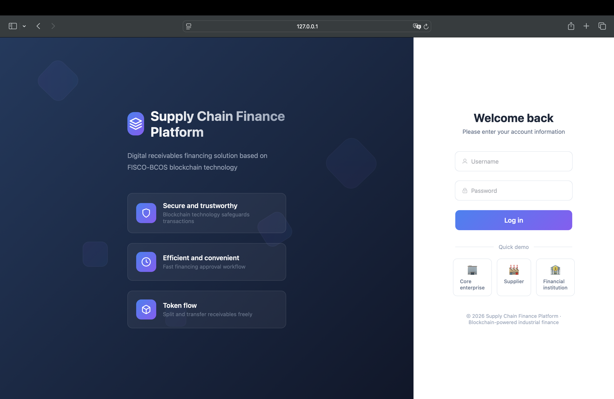
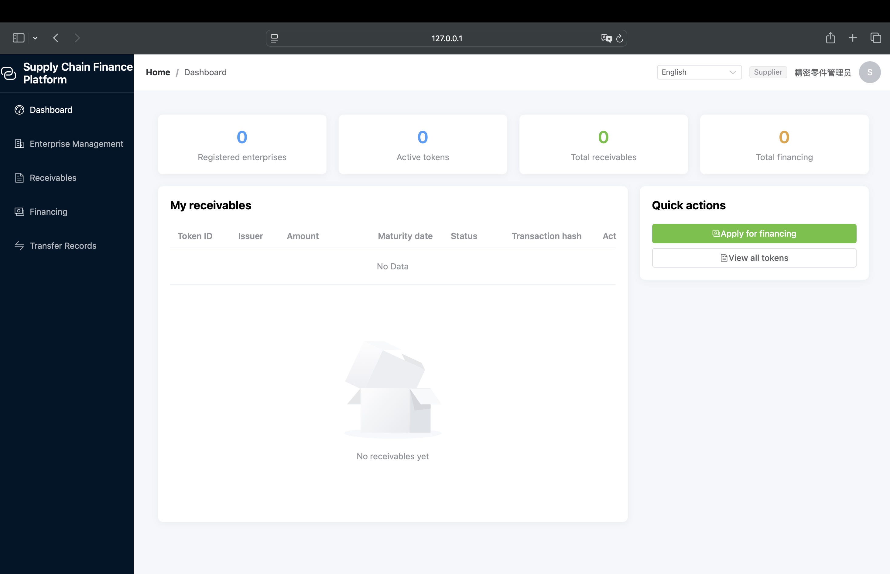
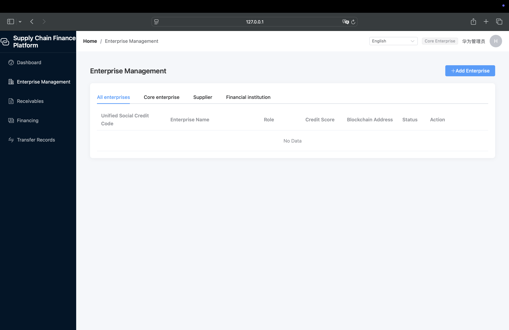
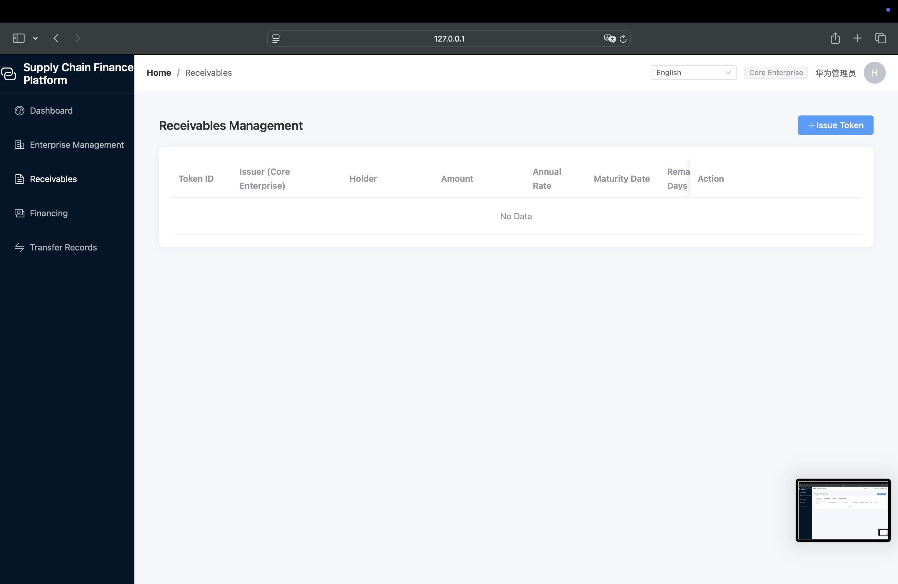
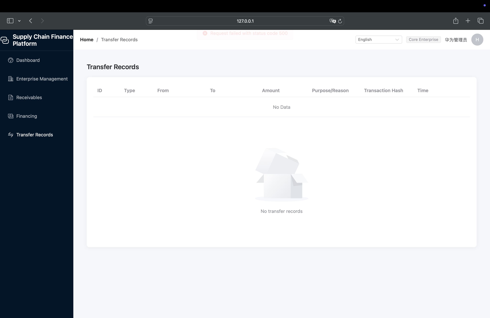

# FISCO-SCF: Blockchain-Enabled Supply Chain Finance Platform

A research-oriented platform for supply chain finance built on FISCO-BCOS, combining blockchain-based receivables management, smart-contract automation, and AI-assisted risk intelligence.

This repository is organized as both a software system and a research archive, making it suitable for academic review, technical demonstration, and external collaboration.

## Project Overview

This project addresses a core problem in modern supply chains: the mismatch between financing demand and traditional credit access. Small and medium enterprises often face financing friction because their receivables are difficult to verify, transfer, and underwrite in a trustworthy and traceable way.

The proposed solution integrates:

- blockchain-based asset tokenization and traceability,
- smart-contract enabled financing workflows,
- enterprise identity and credit governance,
- AI-driven risk assessment and decision support,
- a research-friendly architecture for papers, reports, and academic writing.

The platform is designed to be understandable to both technical stakeholders and research evaluators: it demonstrates a complete chain from data and contracts to user-facing financial workflows.

## Research Positioning

This repository sits at the intersection of:

- blockchain technology and distributed ledger systems,
- financial technology and supply chain finance,
- machine intelligence and credit/risk analysis,
- applied research, engineering, and interdisciplinary scholarship.

It is intended to support:

- platform prototyping and system validation,
- reproducible experiments and evaluation,
- academic writing and publication,
- demonstration to funding, admissions, and research audiences.

## Core Features

- Receivables tokenization and lifecycle tracking
- On-chain enterprise registration and credit governance
- Smart-contract supported financing approval and disbursement
- Transfer, split, and settlement workflows for accounts receivable
- AI-assisted risk scoring and credit decision support
- Platform-oriented dashboards for enterprises, suppliers, and financial institutions
- Research-friendly documentation structure for papers and book chapters

## High-Level Architecture

```text
+---------------------+
|     Users / Roles   |
|  Core Enterprise    |
|  Supplier           |
|  Financial Institution |
|  Regulator          |
+----------+----------+
           |
           v
+---------------------+
|   Frontend Layer    |
|  Vue 3 + Vite       |
|  Dashboard / Forms   |
+----------+----------+
           |
           v
+---------------------+
|   Backend Layer     |
| Spring Boot + REST  |
| JWT + Business APIs |
+----------+----------+
           |
           v
+---------------------+
|   Blockchain Layer  |
| FISCO-BCOS + Solidity|
| Smart Contracts     |
+----------+----------+
           |
           v
+---------------------+
|  AI / Risk Engine   |
| Assessment + Models |
+---------------------+
```

## Technical Stack

| Layer | Technology | Notes |
| --- | --- | --- |
| Frontend | Vue 3, Vite, Element Plus | User dashboards and workflow UIs |
| Backend | Spring Boot, Spring Security, JWT | REST APIs and authentication |
| Database | MySQL, JPA | Structured operational data |
| Blockchain | FISCO-BCOS, Solidity | On-chain asset and workflow logic |
| Smart Contracts | AccessControl, ReceivablesToken | Governance and receivable operations |
| AI / Analytics | Python, model pipelines, risk scoring | Financial reasoning support |
| Build / Runtime | Maven, Node.js, Java 11 | Project execution environment |
| DevOps | GitHub, CI/CD-ready setup | Repository and collaboration support |

## Repository Structure

```text
fisco-scf/
├── README.md
├── LICENSE
├── .gitignore
├── backend/                  # Spring Boot backend
│   ├── src/
│   ├── pom.xml
│   ├── config.toml
│   └── ...
├── frontend/                 # Vue 3 web application
│   ├── src/
│   ├── package.json
│   └── ...
├── blockchain/               # Smart contracts and chain-related assets
│   └── contracts/
├── docs/
│   ├── architecture/
│   ├── papers/
│   ├── book/
│   ├── screenshots/
│   └── reports/
├── research/
│   ├── methodology/
│   ├── experiments/
│   ├── datasets/
│   ├── evaluation/
│   └── results/
├── assets/
│   ├── logo/
│   └── diagrams/
├── scripts/
├── examples/
├── notebooks/
├── tests/
├── images/
└── .github/
```

## Key Research and Product Outcomes

This project is designed around four core outputs:

1. A working supply chain finance platform
   - enterprise onboarding,
   - receivable issuance and confirmation,
   - transfer and splitting,
   - financing request and settlement workflows.

2. A blockchain-backed financial data layer
   - ledger integrity,
   - tamper-resistant transaction records,
   - transparent state transitions.

3. AI-enabled risk intelligence
   - assessment of enterprise and receivable risk,
   - decision support for financing approval,
   - analytics for operational oversight.

4. Academic and scholarly artifacts
   - research notes and methodology,
   - publication-ready content and references,
   - book or report chapters for interdisciplinary dissemination.

## Platform Screenshots

The following figures show the current platform interface and key business workflows.

### Login Screen



### Dashboard Overview



### Enterprise Management



### Receivables Management



### Transfer Records



## Quick Start

### Prerequisites

- Java 11
- Maven
- Node.js 18+
- MySQL 8.0
- FISCO-BCOS environment configured for local or testnet deployment

### Backend

```bash
cd backend
mvn clean install
mvn spring-boot:run
```

### Frontend

```bash
cd frontend
npm install
npm run dev
```

### Typical Local Access

- Frontend: http://localhost:5173
- Backend API: http://localhost:8080/api

## Deployment and Configuration Notes

The backend and blockchain layers are designed to work with a local chain configuration and environment-specific storage settings. For reproducibility, keep all of the following in version control:

- contract ABI and bytecode artifacts,
- network configuration files,
- application configuration templates,
- example datasets and seed credentials for development.

## How to Cite

If you use this repository in a project, paper, or thesis, please cite the project as follows.

Plain text:

FISCO-SCF: Blockchain-Enabled Supply Chain Finance Platform. GitHub repository, available at: https://github.com/yteicos-ItNa07/fisco-scf

BibTeX:

```bibtex
@misc{fisco_scf_2026,
  title = {FISCO-SCF: Blockchain-Enabled Supply Chain Finance Platform},
  author = {Your Name and Collaborators},
  year = {2026},
  howpublished = {GitHub Repository},
  url = {https://github.com/yteicos-ItNa07/fisco-scf}
}
```

If you are preparing a formal paper or dissertation, adapt the citation to your institutional style and append the relevant publication or manuscript reference.

## License

This project is intended for open research, reproducible software development, and academic dissemination. Final license selection will be completed in the repository setup phase (MIT or Apache 2.0).

## Project Status

- Platform prototype: active
- Blockchain integration: active
- Research documentation: in progress
- Publication materials: expanding

## Contact

For collaborations, academic inquiries, or research discussions, please contact the project maintainer:

- Email: [juliana.tsui@outlook.com](mailto:juliana.tsui@outlook.com)
- GitHub: [@yteicos-ItNa07](https://github.com/yteicos-ItNa07)

---

This repository is structured to present both the engineering contribution and the research narrative clearly to reviewers, faculty, students, and collaborators.
